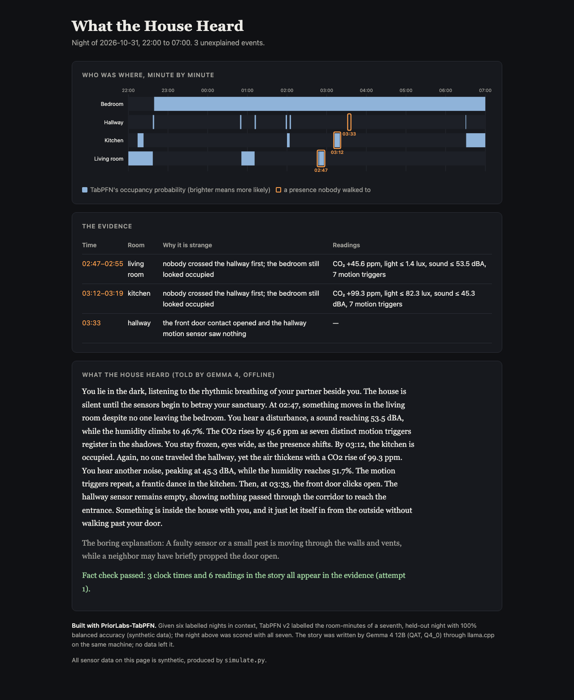

# What the House Heard

A smart home records a lot at night: CO₂, light, sound, motion, the front door. What the House Heard reads one night of
those logs on your own computer and asks a plain question: who was in which room, minute by minute? Anything that looks
like a person in a room nobody walked to gets flagged. A local Gemma model then tells the night back as a short ghost
story, and a fact check makes sure every time and reading in the story comes from the logs.

**Built with PriorLabs-TabPFN.** Made for the DEV Hacktoberfest Open-Source AI Challenge, Week 4: Ghost in the Machine.
**All data in this repository is synthetic** (see `simulate.py`).



## How it works

1. `simulate.py` writes seven ordinary nights for a four-room flat (labelled: which rooms had a person in them) and one
   unlabelled Halloween night. The ordinary nights include the things that fool a naive rule: a cat that sets off
   motion sensors, a lamp left on after bedtime, a fridge compressor that hums every 45 minutes, and a resident who
   cannot sleep and sits in the dark living room. Into Halloween night it injects three events nobody accounts for.
2. `detect.py` gives TabPFN v2 a 3,000-row sample of the labelled nights as context (no training loop) and asks it for
   the probability that each room was occupied in each minute of Halloween night. An event counts as unexplained when
   a room looks occupied for at least two minutes, nobody crossed the hallway in the three minutes before, and the
   bedroom still looks occupied. The front-door contact opening with no hallway motion is flagged too.
3. `narrate.py` turns the events into a short evidence list and sends it to Gemma 4 through llama.cpp's local server.
   The story comes back and is checked: every clock time must fall inside an event, and every reading quoted with a
   unit (ppm, lux, dBA, %) must match the evidence with the same unit. A story that fails is rewritten with the next
   seed, up to four times.
4. `report.py` puts the timeline, the evidence, the story and the check on one self-contained HTML page.

## Run it

```bash
pip install -r requirements.txt
python simulate.py out
python detect.py out out/events.json
```

We tested with `tabpfn` 2.0.9; the first `detect.py` run downloads the TabPFN v2 classifier weights (Prior Labs
License), or pass a local checkpoint with `--model-path`. For the story, start
llama.cpp's server with a Gemma 4 GGUF (we used `gemma-4-12b-it-qat-q4_0.gguf`), then narrate and render:

```bash
llama-server -m gemma-4-12b-it-qat-q4_0.gguf --jinja --reasoning-budget 0 --port 8089
python narrate.py out/events.json out/story.json
python report.py out/events.json out/story.json out/report.html
```

`run.sh` does all of it in one go once the server is up. On a Mac mini (M4, 32 GB), `detect.py` takes about a minute on
the CPU (two TabPFN fits: a held-out check and the real night) and one story takes 25 to 45 seconds at about 8.7 tokens
per second. `docs/sample/` has the outputs of the run shown above.

## What it found on the synthetic Halloween night

- Held-out check: given six labelled nights, TabPFN labelled every room-minute of the seventh correctly (balanced
  accuracy 1.00). Simulated sensors are cleaner than real ones, so read this as "the pipeline works", not as a promise
  for a real home.
- It flagged exactly the three injected events: the living room at 02:47 (dark, CO₂ up 45.6 ppm, 53.5 dBA, seven
  motion triggers), the kitchen at 03:12 (light on, CO₂ up 99.3 ppm), and the front door at 03:33 with no motion in the
  hallway.
- It did not flag the things that only look strange: a resident who sat in the dark living room from 00:51 and another
  walk to the kitchen at 01:58 were explained by the hallway, and the cat's walk at 04:18 was not flagged (in the
  simulation a cat trips motion sensors but adds no CO₂).

## Why open models

The logs say when you sleep, when you get up and when the flat is empty. Here they never leave the machine: TabPFN runs
on the CPU, Gemma runs through llama.cpp, and nothing calls a hosted API, so it costs nothing per night and works with
the Wi-Fi off. Because the weights are local, the checker can rerun the model with a new seed whenever a story misquotes
the evidence, and either model can be swapped. TabPFN learns a new home from a few labelled nights in context, which
suits a problem where every flat is different and nobody wants to train a model per home.

## Using your own logs

Export one row per room per minute with the columns
`night,time,minute,room,co2,light,sound,motion,temp,humidity,door`, plus `occupied` (0 or 1) for the nights you label
yourself. The rooms are `bedroom`, `hallway`, `kitchen` and `living_room`; change `ROOMS` in `features.py` for another
layout, and the hallway rule in `detect.py` if your rooms do not all open onto one hallway.

## Limits

- Everything here runs on simulated data. Real sensors drift, drop out and disagree.
- The fact check covers clock times and readings with units. It does not catch every flourish: a story may still say
  the door "clicks", although a contact sensor records no sound.
- The unexplained-event rule assumes this flat's layout (every room opens onto the hallway, the residents sleep in the
  bedroom).
- We used TabPFN v2 because its weights run offline without an account. Prior Labs recommends TabPFN-3.5; it uses the
  same scikit-learn interface and should drop in after you accept its licence.

## Licences and credits

- Code in this repository: MIT.
- TabPFN by Prior Labs: the `tabpfn` package and the v2 weights are under the Prior Labs License (Apache 2.0 with an
  attribution clause). Built with PriorLabs-TabPFN.
- Gemma 4 by Google: open weights, used under their licence terms and not redistributed here.
- llama.cpp: MIT.
- Built with help from an AI coding assistant (Anthropic Claude).
